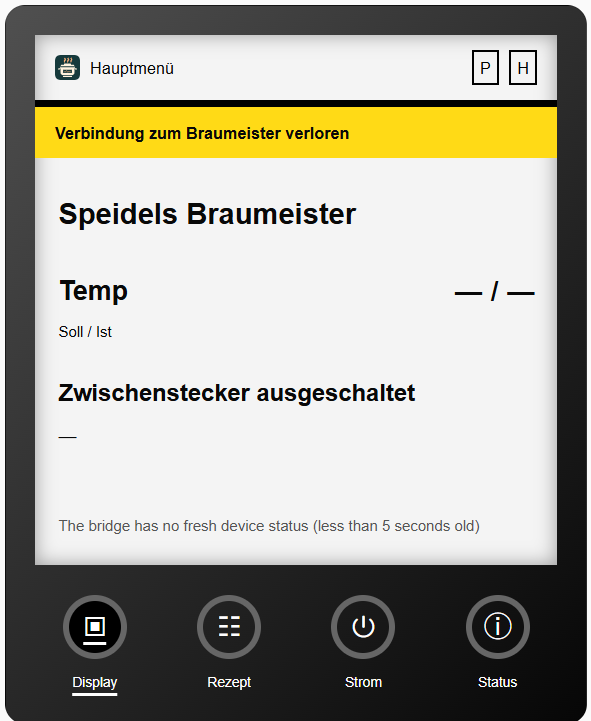
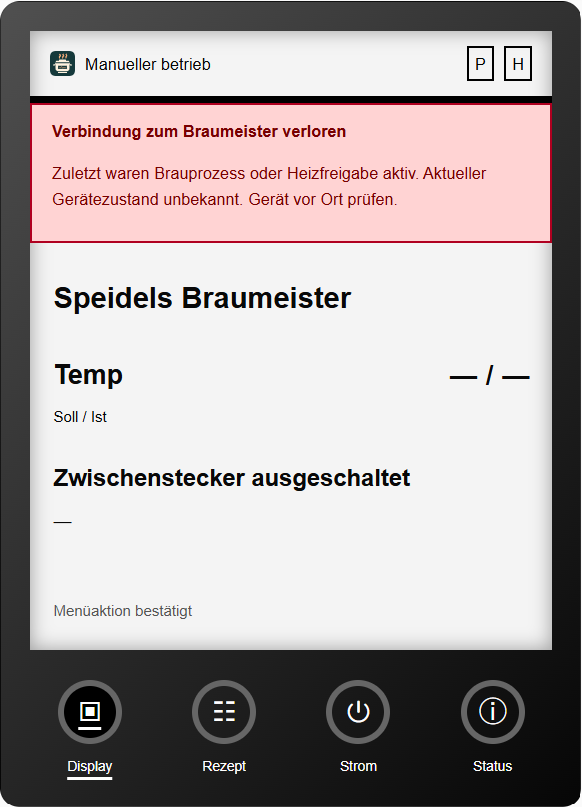

# Passive device connection watchdog

The diagnostic **Check device connection** problem binary sensor observes existing
bridge/XHR updates. Two advancing device timestamps establish freshness. Repeated
cached status, a successful HTTP response or an available Bridge alone do not.
After 120 seconds without advancing evidence, the sensor becomes on. A local
five-second timer keeps the check working when coordinator polls fail or stall.
Recovery is recognized on a subsequent normal integration update; no extra
cloud requests or device probes are sent.

The five-second check does not imply a five-second HA state write. Timer and
coordinator callbacks publish only when the warning, risk, or other meaningful
metadata changes. Timestamp-only advancement is ignored for publication, and
`age_seconds` is not exposed as an entity attribute. `last_device_timestamp` is
a snapshot refreshed when a meaningful state is published (including expiry and
recovery), not a continuously updated age indicator. Healthy unchanged operation
and an unchanged outage therefore do not generate periodic recorder/history rows
from this sensor.

Startup is unknown until advancement is observed. No evidence for 120 seconds
also raises a warning (`evidence: unconfirmed`). Missing/invalid timestamps,
MQTT/API samples without verified device timestamps, source changes and backwards
clock jumps cannot immediately clear a warning. Host monotonic time controls
expiry; the next advancing pair establishes recovery after a source/clock reset.

## Last-known activity

Attributes retain last-known brewing, heater permission, heater output, pump
output and device state code. Unknown/incomplete fields do not overwrite known
activity. Heater `H` means output on, `i` means permission enabled during a
regulation pause, and `h` means permission off. `activity_at_risk` becomes true
during an outage if brewing, heater permission or heater output was last known
active. Pump-only operation is retained but does not raise that risk attribute.
Brewing follows upstream `process_status`, which includes some preparation
screens; it does not prove that a brew was heating.

The sensor stays available when ordinary entities become unavailable after a
coordinator failure. Its state/attributes can drive user-defined notifications
or dashboards. No automatic shutdown, notification or control action is installed.
The Companion and Bridge need no changes for this diagnostic.

These are last-known values, not statements about current physical state. The
watchdog cannot alert while HA is stopped, its event loop is blocked or a browser
is disconnected from HA. Restart/reload resets evidence and retained activity.
It measures telemetry freshness, not every network route or hardware safety.

## Hardware observations reported by the tester

Tested with fork integration **3.1.1-beta.1** and Display Card **0.7.0-beta.7**,
using a Braumeister 20L Plus with firmware V1.1.27 (September 12, 2018). The tester
reported both outcomes in HA and supplied the screenshots below. The Card is a
separate project consuming this diagnostic entity; its UI is not part of this PR.

1. **Idle power-off:** The last known screen was the main menu, with no active
   brew, pump or heater. The tester switched the appliance off using its smart
   plug. The Card displayed the yellow connection warning, masked temperatures
   and showed that the smart plug was off.
2. **Power-off after heating was active:** The tester reported that the red
   warning appeared with the heater previously on. The screenshot shows manual
   mode, the smart plug off, masked temperatures and a warning explicitly saying
   that brewing or heater permission was *last known* active and the current
   device state is unknown. It does not claim the heater remained powered.

Both tests removed power from the appliance. They are not a network-only outage
test with the appliance still energized. The screenshots do not establish the
exact detection delay. Still pending on hardware: recovery/reconnection, outage
during an automatic brew, network-only outage, regulation-pause outage (`i`),
HA restart/reload behavior, and isolated-network/offline operation. Live tests
used German, Celsius, Plato, German date/time formats and Europe/Berlin; alternate
account/system/browser locales, units and related RTC behavior remain pending.

## Automated coverage

Synthetic tests cover frozen samples, missing/invalid timestamps, startup,
source changes, clock regressions, recovery, retained activity, `H`/`i` permission,
coordinator failure visibility and timer cleanup. HA lifecycle is exercised with
HA API stubs, not a full HA runtime. This exact PR branch passed **236 tests and
261 subtests**, full-repository Ruff and `git diff --check`. The fork beta's
separate Card compatibility changes are intentionally
excluded, as are its manifest version bump and release notes.
